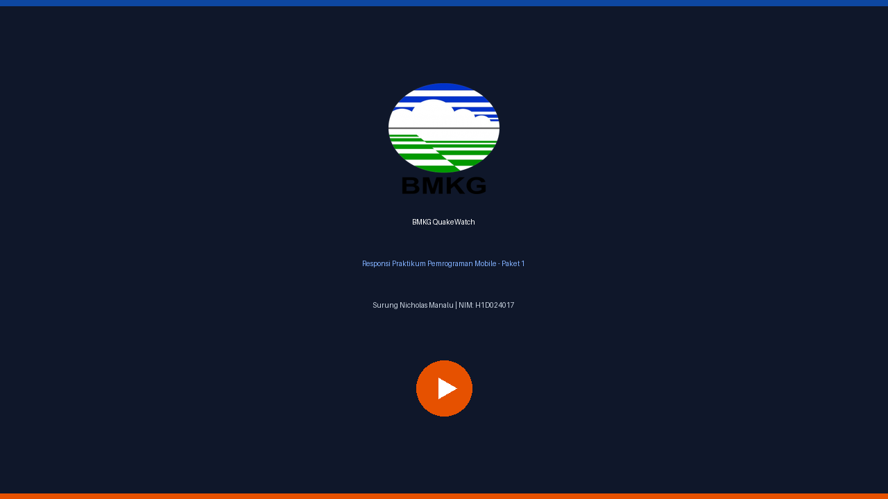
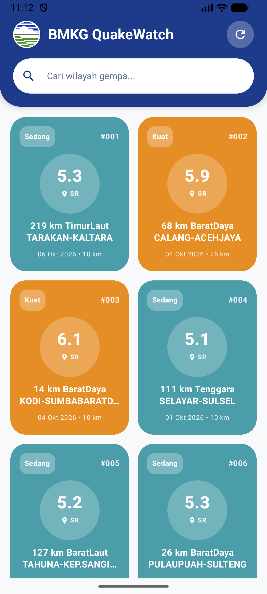
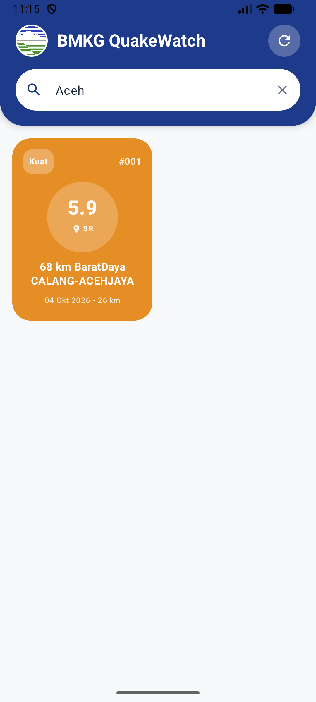
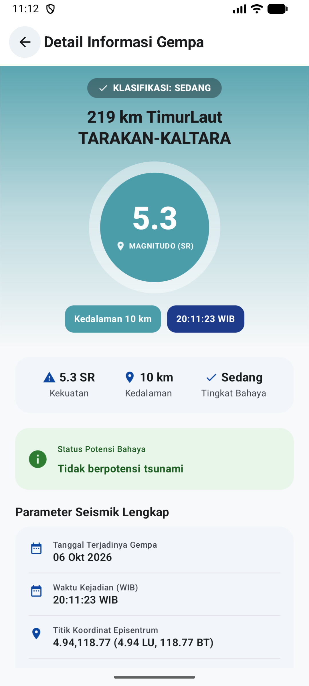

<div align="center">


# BMKG QuakeWatch: Katalog & Monitoring Gempa Terkini
> Aplikasi Mobile Android Modern untuk Katalogisasi, Monitoring Seismik Terkini, dan Deteksi Potensi Tsunami berbasis Jetpack Compose Material 3, REST API BMKG TEWS, dan Arsitektur MVVM.

[](https://github.com/surungmanalu/H1D024017_ResponsiMobile_Paket1)
[](https://developer.android.com)
[](https://kotlinlang.org)

[](https://developer.android.com/jetpack/compose)
[](https://data.bmkg.go.id/)
[](https://square.github.io/retrofit/)

[](https://developer.android.com/topic/architecture)
[](https://github.com/surungmanalu)
[](LICENSE)

</div>

## 👤 Identitas Praktikan
- **Nama Lengkap:** Surung Nicholas Manalu
- **NIM:** H1D024017
- **Program Studi:** S1 Teknik Informatika
- **Fakultas:** Teknik
- **Instansi:** Universitas Jenderal Soedirman (UNSOED)
- **Tugas Responsi:** Paket 1 — Aplikasi Katalog dan Monitoring Gempa BMKG
- **Paket Aplikasi (Package Name):** `com.example.myapplication`
- **Repository GitHub:** [https://github.com/surungmanalu/H1D024017_ResponsiMobile_Paket1](https://github.com/surungmanalu/H1D024017_ResponsiMobile_Paket1)

---

## 🎬 Video Demo & Penjelasan Kode

<div align="center">

[](https://youtu.be/)

<br/>

[](https://youtu.be/)

*Tautan video penjelasan implementasi kode, arsitektur MVVM, dan alur aplikasi.*

</div>

---

## 📱 Deskripsi Aplikasi
Indonesia berada tepat di zona **Cincin Api Pasifik (Pacific Ring of Fire)** dengan frekuensi aktivitas tektonik dan vulkanik yang sangat dinamis. Kebutuhan akan sistem informasi bencana yang cepat, akurat, dan mudah dipahami menjadi hal vital bagi keselamatan masyarakat.

**BMKG QuakeWatch** adalah aplikasi mobile Android berstandar industri yang dirancang untuk memantau data gempa bumi terkini berkekuatan Magnitudo $\ge$ 5.0 di seluruh wilayah Indonesia secara dinamis langsung dari **REST API Terbuka BMKG (Badan Meteorologi, Klimatologi, dan Geofisika)**.

Aplikasi ini menyajikan visualisasi data seismik tanpa beban aset citra yang boros kuota, mengandalkan **Jetpack Compose Material 3** dengan palet warna resmi BMKG (Oceanic Deep Blue, Alert Amber, dan Severity Crimson Red). Seluruh state aplikasi dikelola secara reaktif dan terisolasi menggunakan pola arsitektur **MVVM (Model-View-ViewModel)** dengan `StateFlow` (Pola P5), menjamin ketahanan terhadap perubahan orientasi layar serta stabilitas rekonsiliasi UI.

---

## 🛠️ Penjelasan Teknis

### 1. Spesifikasi & Tech Stack
- **Bahasa Pemrograman:** Kotlin 2.0.21
- **Fitur Modern Kotlin yang Dimanfaatkan:**
  - `data class`: Representasi entitas data model respons API BMKG (`Gempa`, `BmkgResponse`, `InfoGempaContainer`).
  - `Null safety`: Seluruh field bertipe data non-nullable atau memiliki fallback default aman (`""`, `0.0`, `emptyList()`).
  - `Lambda expressions`: Callback navigasi event antar Composable (`onClick: () -> Unit`, `onQueryChange: (String) -> Unit`, `onRetry: () -> Unit`).
  - `Extension functions`: Fungsi ekstensi khusus pada class `Gempa` seperti `getMagnitudeValue()`, `getSeverityCategory()`, dan `isTsunamiWarning()`.
- **UI Framework:** Jetpack Compose (Material Design 3)
- **Min SDK:** 29 (Android 10.0) | **Target SDK:** 36 (Android 16)
- **Pola Arsitektur:** MVVM (Model-View-ViewModel) murni
- **Library Terverifikasi (Strict Compliance):**
  - `Navigation Compose` (`androidx.navigation:navigation-compose:2.8.5`): Manajemen perpindahan layar (Home $\rightarrow$ Detail) dengan argumen type-safe.
  - `Lifecycle ViewModel Compose` (`androidx.lifecycle:lifecycle-viewmodel-compose:2.8.7`): State-driven UI reaktif melalui `StateFlow` pola P5.
  - `Retrofit 2` & `Gson Converter` (`com.squareup.retrofit2:2.11.0`): HTTP Client asynchronous dengan konversi otomatis JSON BMKG ke Data Class Kotlin.
  - *Strict Guard:* Tanpa library image (Coil/Glide ditiadakan sesuai spesifikasi soal).

---

### 2. Fitur Utama & Kepatuhan Spesifikasi Soal

#### A. Kepatuhan Standar UI & Material Design 3 (Scaffold + TopAppBar)
- Seluruh antarmuka dibungkus menggunakan komponen baku `Scaffold` dan `TopAppBar` bergradasi warna oceanic BMKG.
- Kustomisasi menyeluruh pada sistem tema:
  - `Color.kt`: Palet warna primer BMKG Blue (`#0D47A1`), Magma Amber (`#E65100`), Seismic Teal (`#00695C`), dan badge keparahan gempa (Hijau $\le$ 4.9, Kuning 5.0–5.9, Merah $\ge$ 6.0).
  - `Theme.kt`: Mendukung `LightColorScheme` dan `DarkColorScheme` dengan kontras tinggi.
  - `Type.kt`: Override minimal 2 gaya tipografi Material 3 (`headlineMedium`, `titleLarge`, `titleMedium`, `bodyLarge`, `labelLarge`).

#### B. Katalog Gempa dengan LazyColumn & Filter Pencarian Lokal
- Kumpulan data gempa ditampilkan secara eksklusif menggunakan `LazyColumn` yang efisien dan hemat memori.
- Setiap baris gempa (`GempaCard`) menyajikan minimal:
  1. **Tanggal Gempa** beserta jam kejadian.
  2. **Magnitudo** dalam badge melingkar dengan indikator Skala Richter (SR).
  3. **Wilayah Episentrum** dengan ikon penanda lokasi.
  4. **Status Potensi Tsunami** (alert peringatan bahaya atau konfirmasi aman).
- Komponen `GempaSearchBar` menyediakan fitur pencarian real-time untuk menyaring daftar gempa secara lokal berdasarkan nama wilayah (misal: *Tarakan, Banten, Selayar, Kodi, dll*).

#### C. Detail Screen Komprehensif dengan Tombol Back
- Menampilkan parameter seismik lengkap:
  - Tanggal dan Jam Kejadian
  - Titik Koordinat Episentrum (Lintang dan Bujur)
  - Magnitudo dan Kategori Keparahan Gempa
  - Kedalaman Gempa (km)
  - Wilayah Episentrum Lengkap
  - Status Potensi Tsunami
- Dilengkapi tombol kembali (*Back Button*) pada `TopAppBar` yang memanggil `navController.popBackStack()`.

#### D. State-Driven UI & Manajemen Siklus Hidup (MVVM Pola P5)
- UI dibangun berbasis state immutable `GempaUiState`:
  - `GempaUiState.Loading`: Menampilkan indikator loading melingkar saat fetching data jaringan.
  - `GempaUiState.Success`: Menampilkan search bar dan daftar `LazyColumn` atau `EmptyView` jika filter tidak cocok.
  - `GempaUiState.Error`: Menampilkan pesan error jaringan yang informatif disertai tombol interaktif **Coba Lagi (Retry)**.
- Composable tidak pernah memanggil API Retrofit secara langsung; seluruh pemanggilan diisolasi dalam `GempaRepository` dan diekspos oleh `HomeViewModel` melalui `StateFlow`.

---

### 3. Struktur Direktori Proyek

```text
app/src/main/java/com/example/myapplication/
├── data/
│   ├── model/
│   │   ├── BmkgResponse.kt             # DTO Response wrapper BMKG TEWS
│   │   ├── Gempa.kt                    # Data model Gempa dan Kotlin Extension Functions
│   │   └── GempaUiState.kt             # Sealed interface UI State (Loading, Success, Error)
│   ├── remote/
│   │   ├── BmkgApiService.kt           # Interface Retrofit (@GET DataMKG/TEWS/gempaterkini.json)
│   │   └── RetrofitClient.kt           # Singleton konfigurasi Retrofit, OkHttpClient, & Base URL
│   └── repository/
│       └── GempaRepository.kt          # Repository layer: isolasi data & penanganan Result<List<Gempa>>
├── ui/
│   ├── components/
│   │   ├── GempaCard.kt                # Composable kartu gempa dengan badge magnitudo & potensi
│   │   ├── GempaSearchBar.kt           # Search bar real-time filter wilayah lokal
│   │   └── StateComponents.kt          # Reusable composable LoadingView, ErrorView, & EmptyView
│   ├── navigation/
│   │   ├── NavGraph.kt                 # NavHost 2 layar (HomeScreen & DetailScreen)
│   │   └── Screen.kt                   # Sealed class rute navigasi aplikasi
│   ├── screens/
│   │   ├── detail/
│   │   │   └── DetailScreen.kt         # Layar rincian parameter seismik & tombol back
│   │   └── home/
│   │       ├── HomeScreen.kt           # Layar katalog utama, TopAppBar, search bar, & LazyColumn
│   │       └── HomeViewModel.kt        # Pengelolaan StateFlow, filter pencarian, & fetch API
│   └── theme/
│       ├── Color.kt                    # Definisi warna tema BMKG & tingkat keparahan magnitudo
│       ├── Theme.kt                    # Konfigurasi Light / Dark ColorScheme Material 3
│       └── Type.kt                     # Override tipografi Material 3
└── MainActivity.kt                     # Entry point Activity yang memuat BmkgNavGraph
```

---

## 📸 Tangkapan Layar Aplikasi (Screenshots)

<div align="center">

| 1. Katalog Gempa (Home Screen) | 2. Pencarian Wilayah Real-Time | 3. Detail Seismik (Detail Screen) |
|:---:|:---:|:---:|
|  |  |  |

</div>

---

## 📬 Pengujian API (Postman Collection)
Koleksi Postman resmi disertakan pada akar proyek:
- Berkas: `BMKG_Earthquake_API_Postman_Collection.json`
- Mendukung pengujian:
  1. `GET Gempa Terkini M ≥ 5.0`: Validasi endpoint `https://data.bmkg.go.id/DataMKG/TEWS/gempaterkini.json`.
  2. `GET Gempa Dirasakan`: Pengujian respon cadangan aktivitas gempa daratan BMKG.

---

## 🚀 Cara Menjalankan Proyek

1. **Prasyarat:**
   - Android Studio (versi Ladybug / Koala / Hedgehog atau lebih baru disarankan).
   - JDK 17 atau lebih baru.
   - Perangkat Android fisik dengan mode *USB Debugging* aktif atau Android Emulator (API 29+).
   - Koneksi internet aktif untuk mengambil data langsung dari server BMKG.

2. **Langkah Instalasi & Eksekusi:**
   ```bash
   # 1. Clone repository
   git clone https://github.com/surungmanalu/H1D024017_ResponsiMobile_Paket1.git

   # 2. Masuk ke direktori
   cd H1D024017_ResponsiMobile_Paket1

   # 3. Jalankan unit test untuk memastikan integritas logika
   ./gradlew test

   # 4. Bangun APK Debug
   ./gradlew assembleDebug
   ```
3. Buka proyek pada **Android Studio**, tunggu hingga proses Gradle Sync selesai, lalu klik tombol **Run (`Shift + F10`)**.
